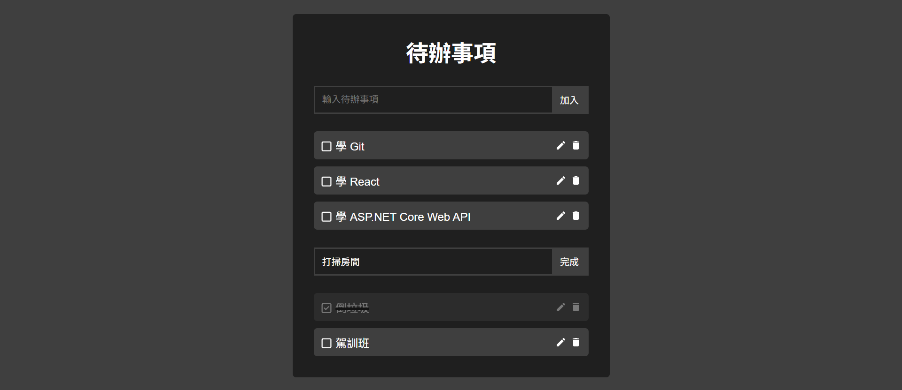
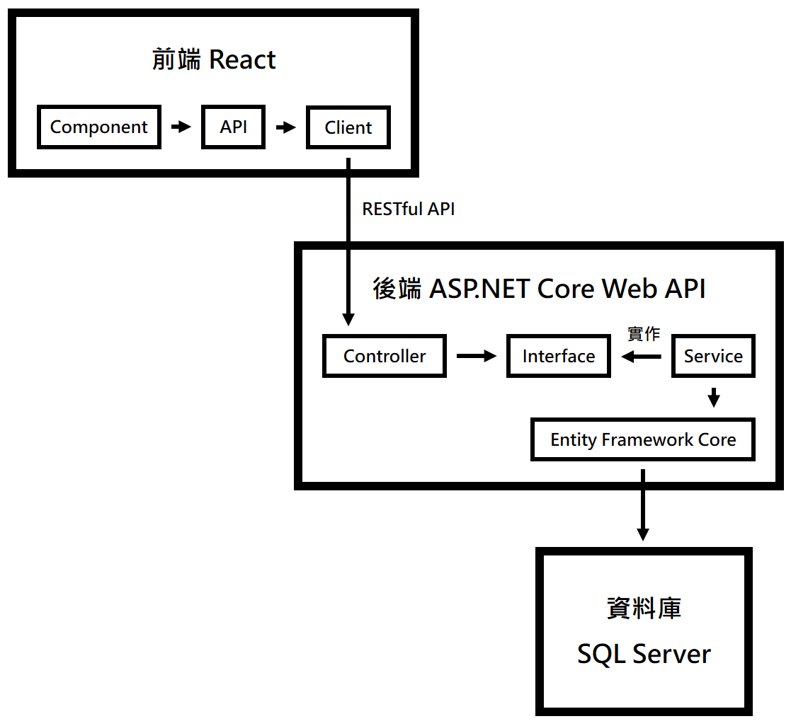

# **Todo 全端網頁應用程式**

## **專案介紹**
本專案是由 React 與 ASP.NET Core Web API 開發的 Todo 全端網頁應用程式。採用前後端分離架構，透過 RESTful API 進行資料交換，並使用 Entity Framework Core 存取 SQL Server。

本專案功能相對精簡，主要提供 Todo 的新增、刪除、編輯與完成狀態切換功能。在架構上著重於**職責分離與降低模組間的耦合**，讓各層維持明確的責任。

## **專案展示**
### **快速導覽影片 ( 總長 2:40 )**
https://youtu.be/6q_BbHyovn4
- 0:00 功能展示
- 0:50 分層架構與職責分離 ( 含圖、程式碼 )
- 1:42 錯誤處理 ( 含圖、程式碼 )
### **主畫面**


## **技術與開發環境**
### **前端**
- React
- Vite
- JavaScript
### **後端**
- ASP.NET Core Web API
- Entity Framework Core
- C#
### **資料庫**
- SQL Server
### **開發工具**
- Visual Studio Code
- Visual Studio
### **版本控制**
- Git

## **分層架構與職責分離**
本專案依照不同職責進行分層，降低元件之間的耦合，提升程式的可維護性。
### **分層架構**

### **元件職責**
| **元件** | **職責** |
| --- | --- |
| Component | 負責畫面呈現與使用者互動 |
| API | 定義 API 的呼叫方式，包含 method、headers、body |
| Client | 負責發送 HTTP Request 與接收 HTTP Response |
| Controller | 負責接收 HTTP Request，呼叫對應的 `Service` ，並回傳 HTTP Response |
| Interface | 定義 `Service` 提供的方法 |
| Service | 負責應用邏輯與資料操作 |
| Entity Framework Core | 負責資料庫存取 |
| SQL Server | 負責儲存資料 |
### **設計說明**
- DTO 負責 API 資料傳輸。Request DTO 定義 API 接收的資料結構與驗證規則，避免不合法的資料進入後端邏輯；Response DTO 定義 API 回傳的資料，避免直接暴露 `Entity` 的所有欄位。
- `Service` 透過 `Interface` 定義對外提供的方法，`Controller` 只依賴 `Interface`，降低 `Controller` 與 `Service` 具體實作之間的耦合。

## **專案結構**
```
Todo/
|__ frontend/                         # React 專案
|    |__ index.html                   # 網頁入口
|    |__ src/
|    |    |__ main.jsx                # React 程式入口
|    |    |__ App.jsx                 # 根元件
|    |    |__ components/             # Component：UI 元件
|    |    |    |__ TodoWrapper.jsx
|    |    |    |__ CreateForm.jsx
|    |    |    |__ Todo.jsx
|    |    |    |__ EditForm.jsx
|    |    |__ api/
|    |    |    |__ todoApi.js         # API：API 定義
|    |    |    |__ client.js          # Client ： HTTP 通訊
|
|__ backend/
|    |__ backend/                     # ASP.NET Core Web API 專案
|    |    |__ Program.cs              # ASP.NET Core Web API 程式入口
|    |    |__ Controllers/            # Controller
|    |    |    |__ TodoController.cs
|    |    |__ Dtos/                   # DTO：API 資料傳輸
|    |    |    |__ TodoDto.cs
|    |    |    |__ AddTodoDto.cs
|    |    |    |__ EditTodoDto.cs
|    |    |__ Services/
|    |    |    |__ ITodoService.cs    # Interface
|    |    |    |__ TodoService.cs     # Service
|    |    |__ Models/                 # Entity Framework Core
|    |    |    |__ TodoAppContext.cs
|    |    |    |__ Todo.cs
```

## **API 設計**
| **方法** | **路徑** | **說明** |
| --- | --- | --- |
| GET | `/api/todo` | 取得多筆 Todo |
| GET | `/api/todo/{id}` | 取得單筆 Todo |
| POST | `/api/todo` | 新增 Todo |
| DELETE | `/api/todo/{id}` | 刪除 Todo |
| PUT | `/api/todo/{id}` | 編輯 Todo |
| PATCH | `/api/todo/{id}` | Todo 已完成 / 未完成狀態切換 |
### **設計說明**
- 「新增 Todo」的 API 會使用 `CreatedAtAction` 回傳 `201 Created`。因為 `CreatedAtAction` 會根據指定的 `Action` 與 `Route Value` 產生新建立 Todo 的 URL，並將該 URL 放入 `Location Header` 中，所以設計「取得單筆 Todo」的 API，作為 `CreatedAtAction` 產生 URL 的依據。

## **錯誤處理**
後端針對不同的錯誤類型，在適當的層級進行處理，並統一錯誤回應格式。前端根據回傳的錯誤回應，使用 `Toast` 顯示錯誤訊息。
### **錯誤類型**
| **狀態碼** | **處理方式** |
| --- | --- |
| 400 Bad Request | 使用 `[ApiController]` 啟用自動模型驗證錯誤處理機制，當驗證失敗時，透過 `InvalidModelStateResponseFactory` 產生自訂的錯誤回應 |
| 404 Not Found | 當 `Service` 查詢失敗時，將結果傳給 `Controller`，由 `Controller` 根據結果回傳 404 Not Found |
| 500 Internal Server Error | 當發生未處理的例外時，由 `GlobalExceptionMiddleware` 統一攔截，並產生自訂的錯誤回應 |

### **檔案結構**
```
backend/
|__ Errors/
|    |__ ErrorResponse.cs
|    |__ ErrorCode.cs
|    |__ ErrorResponseFactory.cs
|    |__ GlobalExceptionMiddleware.cs
```
### **設計說明**
- `ErrorResponse` 定義統一的錯誤回應格式，包含 `ErrorCode` 和 `Message`，分別用於識別錯誤類型與提供錯誤訊息，讓 API 維持一致的錯誤回應格式。
- `ErrorCode` 集中管理錯誤代碼，作為錯誤類型的識別依據。
- `ErrorResponseFactory` 集中管理不同錯誤類型對應的 `ErrorResponse` 建立邏輯，避免不同錯誤處理流程各自建立 `ErrorResponse`。
- `GlobalExceptionMiddleware` 統一攔截未處理的例外，並將 HTTP Status Code 設為 `500`，避免各 `Controller` 分別處理例外。

## **資料庫與資料存取**
資料庫採用 Code First 開發方式，透過 `Entity` 定義資料模型，並使用 Entity Framework Core 的 `Migration` 建立及更新資料庫結構。
### **設計說明**
- `DbContext` 負責管理 `Entity` 與資料庫操作，透過 `Connection String` 設定資料庫連線，並於 `Program.cs` 中註冊其 DI ( Dependency Injection，依賴注入 )，由 DI 管理 `DbContext` 的生命週期。
- 透過 `Fluent API` 設定 `Entity` 的資料庫映射規則，並於 `DbContext` 中使用 `ApplyConfigurationsFromAssembly()` 自動套用 `Assembly` 中的所有 `Configuration`，避免逐一註冊 `Entity Configuration`。
- 透過 Entity Framework Core 的 `Migration` 管理資料庫結構，讓資料庫結構變得更具版本控制。當 `Entity` 與 `Configuration` 發生變更時，產生新的 `Migration`，記錄資料庫結構的變更，並透過 `Migration` 將變更套用到資料庫。

## **執行方式**
### **前置作業**
安裝以下開發環境：
- Visual Studio Code ( VS Code )
- Node.js
- Visual Studio，並勾選「ASP.NET 與網頁程式開發」
- .NET 8.0
- SQL Server Express
- SQL Server Management Studio ( SSMS )
### **前端設定**
1. 使用 VS Code 開啟前端專案資料夾 ( frontend )，並開啟 Terminal。
2. 在 Terminal 輸入指令，安裝專案需要的套件。
    ```
    npm install
    ```
3. 在 Terminal 輸入指令，啟動開發伺服器。
    ```
    npm run dev
    ```
4. 用瀏覽器開啟 `http://localhost:5173/` ( 依實際 Vite 顯示的 Port 為準 )。
    - 若前端 Vite 啟動後的 Port 不是 5173，需同步修改後端 `Program.cs` 裡 CORS 允許的網址 ( `WithOrigins` )，避免瀏覽器發生 CORS 問題。
### **後端與資料庫設定**
1. 開啟 SSMS，連線到 SQL Server，手動新增一個空白資料庫。
2. 使用 Visual Studio 開啟後端專案的 `.sln` 方案檔。
3. 在右側「方案總管」中，對專案名稱「右鍵」→「管理使用者密碼」，Visual Studio 會開啟 User Secrets 的 `secrets.json` 檔案，根據環境進行相關設定。
    - SQL Server 驗證
        ```
        {
            "ConnectionStrings": {
                "TodoAppDatabase": "Server=伺服器位置;Database=資料庫名稱;User ID=帳號;Password=密碼;TrustServerCertificate=true"
            }
        }
        ```
    - Windows 驗證
        ```
        {
            "ConnectionStrings": {
                "TodoAppDatabase": "Server=伺服器位置;Database=資料庫名稱;Trusted_Connection=True;TrustServerCertificate=true"
            }
        }
        ```
4. 在 Visual Studio 上方選擇「檢視」→「其他視窗」→「套件管理主控台」。在下方套件管理主控台輸入指令，EF Core 會將尚未套用的 `Migration` 套用到資料庫。
    ```
    Update-Database
    ```
5. 在 Visual Studio 中按下「啟動」按鈕，啟動後端專案。
